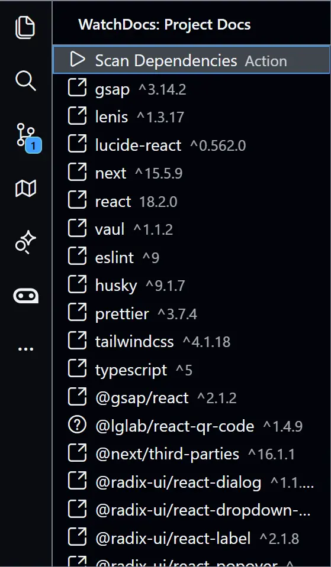

# WatchDocs

> Auto-detect project dependencies and jump directly to their official documentation

---

## Overview

WatchDocs is a VS Code extension that streamlines development by automatically scanning your workspace for dependency manifest files (`package.json`, `Cargo.toml`, `go.mod`, `requirements.txt`, `pyproject.toml`, `pom.xml`, `pubspec.yaml`), extracting the listed packages, and providing instant clickable links to their official documentation.

**Who it's for:**
- Developers working with multiple dependencies across different ecosystems
- Teams who frequently reference documentation during development
- Anyone who wants to reduce time spent searching for docs

**Problem it solves:**
- No more manually searching for documentation URLs
- Eliminates bookmarking and maintaining doc links
- Provides a centralized view of all project dependencies with direct access to their docs

---

## Preview



*Sidebar showing detected dependencies with clickable documentation links*

---

## Features

- **Auto Dependency Detection** - Scans workspace for manifest files (`package.json`, `requirements.txt`, `pyproject.toml`, `go.mod`, `Cargo.toml`, `pom.xml`, `pubspec.yaml`)
- **Two-Tier Resolution Engine** - Local registry cache → Online registries for maximum coverage
- **High-Performance Worker Pool** - 16-concurrency worker pool for rapid dependency resolution
- **Multi-Ecosystem Support** - npm, pip, go, cargo, maven, pub
- **Interactive Sidebar** - View all dependencies in one place with one-click doc access
- **Progressive UI Updates** - Results appear incrementally in batches of 4 as they're resolved
- **Smart Caching** - 277+ packages in local registry (offline), with online fallback for real-time resolution

---

## Installation

### From VS Code Marketplace

1. Open VS Code
2. Press `Ctrl+Shift+X` (or `Cmd+Shift+X` on Mac) to open Extensions view
3. Search for "WatchDocs"
4. Click **Install**
5. The WatchDocs icon will appear in the Activity Bar

### From CLI

```bash
code --install-extension watchdocs.watchdocs
```

---

## Usage

### Basic Usage

1. **Open your project** in VS Code
2. **Click the WatchDocs icon** in the Activity Bar (left sidebar)
3. **Click "Scan Dependencies"** (play button) in the sidebar
4. **Wait for resolution** - dependencies will appear as they're found
5. **Click any dependency** to open its official documentation in your browser

### Example

**Input:**
```
Workspace contains:
- /my-project/package.json (with react, next, express)
- /my-project/requirements.txt (with django, requests)
- /my-project/go.mod (with gin, gorm)
```

**Output:**
```
Sidebar displays:
├── Scan Dependencies ▶
├── react 18.2.0 → https://react.dev/
├── next 14.1.0 → https://nextjs.org/docs
├── express 4.18.0 → https://expressjs.com/
├── django 4.2.0 → https://docs.djangoproject.com/
├── requests 2.31.0 → https://requests.readthedocs.io/
├── gin 1.9.1 → https://pkg.go.dev/github.com/gin-gonic/gin
├── gorm 1.25.7 → https://gorm.io/
└── tokio 1.35.0 → https://docs.rs/tokio
```

---

## Commands

| Command | Description |
|---------|-------------|
| `watchdocs.scan` | Scan workspace for dependencies and resolve documentation URLs |
| `watchdocs.refreshTreeView` | Refresh the dependency tree view |
| `watchdocs.helloWorld` | Show "Hello from WatchDocs!" message (debug) |

Access commands via Command Palette (`Ctrl+Shift+P` / `Cmd+Shift+P`)

---

## Keybindings

No default keyboard shortcuts. You can add custom keybindings in `keybindings.json`:

```json
[
  {
    "key": "ctrl+shift+d",
    "command": "watchdocs.scan",
    "when": "editorTextFocus"
  }
]
```

---

## How It Works

### Overview

WatchDocs uses a **two-tier hybrid resolution strategy**:
1. **Local Registry Cache** (fastest, offline-capable) - Checks pre-populated JSON registries (277+ packages across 6 ecosystems)
2. **Online Registries** (fast, requires internet) - Fetches homepage URLs directly from npmjs.org, PyPI, pkg.go.dev, crates.io, Maven Central, and pub.dev in parallel using a 16-concurrency worker pool

This approach ensures fast resolution for popular packages while maintaining coverage for niche dependencies. Packages not found in either tier are not displayed.

### Execution Flow

1. **Trigger** - User clicks "Scan Dependencies" button in sidebar
2. **File Discovery** - Scanner searches workspace for manifest files (`package.json`, `requirements.txt`, `pyproject.toml`, `go.mod`, `Cargo.toml`, `pom.xml`, `pubspec.yaml`)
3. **File Reading** - Reader loads each manifest file using VS Code's virtual file system, by getting utf-8 then converting to string
4. **Parsing** - Ecosystem-specific parsers extract dependency names and versions from string of each file
5. **Resolution** - Main resolver orchestrates two-tier lookup:
   - Tier 1: Local registry cache (instant)
   - Tier 2: Online registry fetch via 16-concurrency worker pool (npm, pip, go, cargo, maven, pub)
6. **Display** - Results rendered incrementally in batches of 4 in sidebar tree view, with registry lookup at instant

### Core Components

| Component | Responsibility |
|-----------|----------------|
| `DocsTreeProvider` | Manages sidebar tree state and user interactions |
| `scanWorkspace()` | Finds all manifest files with include/exclude patterns |
| `readFile()` | Reads file content from VS Code's virtual file system |
| `parsers/` | Ecosystem-specific parsers for npm, pip, go, cargo, maven, and pub |
| `resolver()` | Orchestrates two-tier resolution strategy with batch progress callbacks |
| `registryResolver()` | Looks up docs from local JSON registries |
| `online*Resolver()` | Fetches documentation URLs from online registries (npm, pip, go, cargo, maven, pub) in real-time |
| `cache` | In-memory registry cache |

### Data Flow

```
User Action (Click Scan)
    ↓
DocsTreeProvider.scan()
    ↓
scanWorkspace() → [package.json, Cargo.toml, go.mod, ...]
    ↓
readFile() → file contents
    ↓
parsers → Dependency[]
    ↓
resolver()
    ├─→ registryResolver() → DocResult[] (found)
    └─→ Worker Pool (16 concurrency)
          ├─→ onlineNpmResolver() → DocResult[] (npm packages)
          ├─→ onlinePipResolver() → DocResult[] (pip packages)
          ├─→ onlineGoResolver() → DocResult[] (go packages)
          ├─→ onlineCargoResolver() → DocResult[] (cargo packages)
          ├─→ onlineMavenResolver() → DocResult[] (maven packages)
          └─→ onlinePubResolver() → DocResult[] (pub packages)
    ↓
Sidebar Tree View (updates in batches of 4)
```

### Walkthrough

**Scenario:** User has a React + Express + Axios project

1. User clicks **Scan Dependencies** in sidebar
2. Extension searches workspace, finds `/src/package.json`
3. Reads file content: `{"dependencies": {"react": "^18.2.0", "express": "^4.18.0", "axios": "^1.6.0"}}`
4. Parses to: `[{name: "react", version: "18.2.0", ecosystem: "npm"}, ...]`
5. Calls `resolver()` with progress callback
6. **Tier 1 - Registry lookup:**
   - Loads `npm.json` from resources (cached in memory)
   - Finds "react" → `https://react.dev/`
   - Finds "express" → `https://expressjs.com/`
   - Package "axios" not found in local cache
7. **Tier 2 - Online NPM lookup via Worker Pool:** (for missing npm packages)
   - Fetches `https://registry.npmjs.org/axios/latest`
   - Extracts `homepage` field from response
   - Returns `https://axios-http.com/`
8. Progress callback updates UI incrementally in batches of 4
9. Sidebar displays all resolved dependencies with external link icons
10. User clicks "react" → browser opens `https://react.dev/`

---

## Architecture

### Project Structure

```
watchdocs/
├── src/
│   ├── extension.ts           # Entry point, command registration
│   ├── models.ts              # TypeScript interfaces and types
│   ├── ui/
│   │   └── tree-provider.ts   # Sidebar TreeDataProvider implementation
│   ├── core/
│   │   ├── scanner/
│   │   │   └── scanner.ts     # Workspace file discovery
│   │   ├── reader/
│   │   │   └── reader.ts      # File content reader
│   │   ├── parsers/
│   │   │   ├── index.ts       # Parser exports
│   │   │   ├── parse-package-json.ts      # npm parser
│   │   │   ├── parse-requirements.ts      # pip parser
│   │   │   ├── parse-pyproject-toml.ts    # pip parser (pyproject.toml)
│   │   │   ├── parse-go-mod.ts            # go parser
│   │   │   ├── parse-cargo-toml.ts        # cargo parser
│   │   │   ├── parse-pom-xml.ts           # maven parser
│   │   │   └── parse-pubspec-yaml.ts      # pub parser
│   │   ├── resolver/
│   │   │   ├── resolver.ts    # Main orchestrator (two-tier)
│   │   │   ├── registry-resolver.ts       # Local registry lookup
│   │   │   ├── online-npm-resolver.ts     # NPM online resolver
│   │   │   ├── online-pip-resolver.ts     # PyPI online resolver
│   │   │   ├── online-go-resolver.ts      # Go online resolver
│   │   │   ├── online-cargo-resolver.ts   # crates.io online resolver
│   │   │   ├── online-maven-resolver.ts   # Maven online resolver
│   │   │   └── online-pub-resolver.ts     # pub.dev online resolver
│   │   └── cache/
│   │       └── cache.ts       # In-memory registry cache
│   └── test/
│       ├── extension.test.ts  # Extension test suite
│       ├── parser.test.ts     # Parser unit tests
│       └── pip-resolver.test.ts # Pip resolver unit tests
├── resources/
│   ├── watchdocs-v2.svg       # Extension icon
│   └── registries/
│       ├── npm.json           # 85+ npm package URLs
│       ├── pip.json           # 70+ pip package URLs
│       ├── go.json            # 18 Go package URLs
│       ├── cargo.json         # 65+ Rust crate URLs
│       ├── maven.json         # 3 Java library URLs
│       └── pub.json           # 17 Dart/Flutter package URLs
├── dist/                      # Bundled extension output (git-ignored)
├── out/                       # Test build output (git-ignored)
├── package.json               # Extension manifest
├── tsconfig.json              # TypeScript configuration
└── esbuild.js                 # Build bundler configuration
```

### Module Responsibilities

| Module | Responsibility |
|--------|----------------|
| `extension.ts` | Activation, command registration, lifecycle management |
| `models.ts` | Type definitions (`Dependency`, `DocResult`, `DocResolver`, `ManifestFile`) |
| `tree-provider.ts` | Sidebar UI, scan orchestration, tree item rendering |
| `scanner.ts` | File discovery with glob patterns and exclusions |
| `reader.ts` | UTF-8 file reading via VS Code FS API |
| `parsers/` | Ecosystem-specific dependency extraction |
| `resolver.ts` | Two-tier resolution orchestration with progress callbacks |
| `registry-resolver.ts` | Fast local JSON registry lookup with caching |
| `online-*-resolver.ts` | Real-time registry fetchers for npm, pip, go, cargo, maven, pub |
| `cache.ts` | Session-based in-memory registry caching |

---

## Known Issues

- **Limited Pip Format Support** - Only handles `package==version` format; does not support `>=`, `<=`, `~=`, or extras
- **No DevDependency Distinction** - npm `devDependencies` shown alongside `dependencies` without visual distinction
- **Single Workspace Limitation** - Only scans first workspace folder in multi-root workspaces

Report issues on the [GitHub repository](#).

---

## Roadmap

### v0.2.1 (Current)
- [x] High-Performance Worker Pool (16 concurrency)
- [x] Incremental UI Updates (batches of 4)
- [x] Implemented `go.mod` parser and online resolution
- [x] Implemented online NPM resolver for real-time registry fetches
- [x] Two-tier resolution strategy (local → online)

### v0.3.0 (Planned)
- [ ] Visual distinction between dependencies and devDependencies
- [ ] Visual distinction between dependencies and devDependencies
- [ ] Automatic rescanning on manifest file changes
- [ ] Version-specific documentation links
- [ ] Offline mode toggle (disable AI calls)
- [ ] Custom registry JSON support (user-provided)
- [ ] Documentation preview panel (embedded docs)

### Future Considerations
- [ ] Multi-root workspace support
- [ ] Dependency update notifications
- [ ] Security vulnerability alerts
- [ ] Documentation search within sidebar
- [ ] Export dependency list (Markdown, JSON)

---

## Release Notes

### 0.2.1-alpha (2026-05-05)
- **High-Performance Worker Pool**: Implemented a 16-concurrency worker pool for rapid dependency resolution.
- **Incremental UI Updates**: Dependency results now appear in batches of 4 for better UI responsiveness.
- **Go Support**: Added full support for `go.mod` files and online Go dependency resolution.
- **Pip Support**: Added full support for `requirements.txt` & `pyproject.toml` files and online pip dependency resolution.
- **Fuzzy Search**: Filter sidebar items using fuzzysort.

### 0.2.0-alpha (2026-04-01)
- Implemented online NPM resolver for real-time registry fetches
- Three-tier resolution strategy (local → online → AI)
- Improved coverage for npm packages not in local registry
- Updated documentation with new resolution flow

### 0.1.0-alpha (2026-03-30)
- **Initial alpha release**
- Core dependency scanning for npm and pip ecosystems
- Hybrid resolution engine (registry + Gemini AI)
- Interactive sidebar with clickable documentation links
- Secure API key storage using VS Code secrets
- Pre-populated registry with 260+ popular packages
- Progress reporting with incremental UI updates
- Parser unit tests and standalone test scripts

---

## Development Setup

### Prerequisites
- Node.js 18+ and npm
- VS Code 1.90.0 or later
- [Extension Development Host](https://code.visualstudio.com/api/get-started/your-first-extension) (recommended)

### Clone and Install

```bash
git clone <repo-url>
cd watchdocs
npm install
```

### Build

```bash
# Development build with sourcemaps
npm run compile

# Watch mode (auto-rebuild on changes)
npm run watch

# Production build (minified)
npm run package
```

### Debug

1. Press `F5` to launch Extension Development Host
2. A new VS Code window opens with the extension loaded
3. Set breakpoints in `src/` files for debugging

---

## Testing

### Run Tests

```bash
# Compile tests and run
npm test
```

### Test Coverage

Tests located in `src/test/`:
- `extension.test.ts` - Extension activation and command tests
- `parser.test.ts` - Parser unit tests (npm, pip)
- `pip-resolver.test.ts` - Online pip resolver tests

### Write New Tests

1. Create test file matching pattern `*.test.ts`
2. Use Mocha assertion library (`assert.strictEqual`, etc.)
3. Run tests via Testing view in VS Code or `npm test`

---

## Contributing

Contributions are welcome! Here's how to help:

### Ways to Contribute
- **Add Registry Entries** - Submit PRs adding popular packages to `resources/registries/*.json`
- **New Parsers** - Implement parsers for additional manifest formats (Cargo.toml, pom.xml, etc.)
- **Bug Fixes** - Report and fix issues via GitHub
- **Feature Requests** - Open issues with detailed use cases
- **Documentation** - Improve README, add examples, fix typos

### Development Guidelines
1. Follow existing code style (2-space indentation, TypeScript strict mode)
2. Add tests for new functionality
3. Update README for user-facing changes
4. Use meaningful commit messages

### Submitting a PR
1. Fork the repository
2. Create a feature branch (`git checkout -b feature/add-cargo-parser`)
3. Make changes and test locally
4. Commit with clear messages
5. Open pull request with description

---

## License

This project is licensed under the MIT License - see the [LICENSE](LICENSE) file for details.

---

## Acknowledgements

- **[Keep a Changelog](https://keepachangelog.com/)** - Changelog format inspiration
- **[VS Code Extension API](https://code.visualstudio.com/api)** - Extension framework and documentation
- **Package Maintainers** - All the open-source projects whose documentation is linked

---

## Support

- **Documentation:** This README
- **Issues:** [GitHub Issues](#)

---

**Made with ❤️ for developers by developers@CSI**
